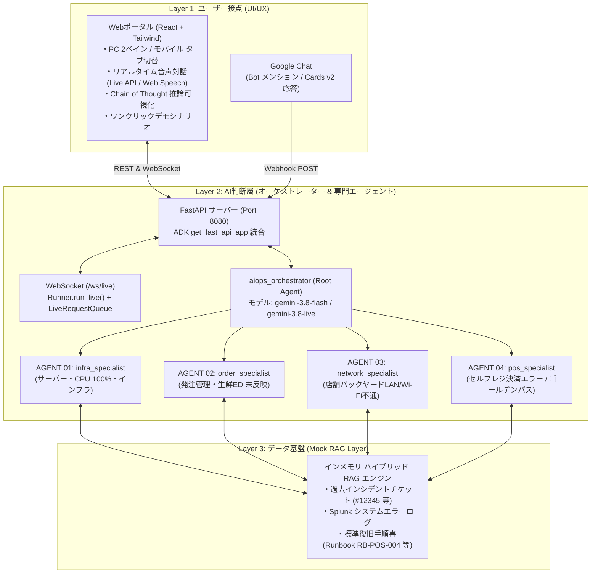

# retail-common-agents

**小売店舗向け AIOps マルチエージェント（運用自動切り分けデモ基盤）**

運用担当者からのシステム障害や仕様に関する問い合わせを自然言語（テキストおよびリアルタイム双方向音声）で受け付け、マルチエージェント型 AI が自動で一次切り分けと解決支援を行う AIOps 運用基盤のデモアプリケーションです。

Google **ADK 2.x (`google-adk >= 2.6.0`)** および **`agents-cli`** に準拠し、ローカル開発環境および **Google Cloud Run** 上で単一コンテナ・インメモリ完結で超軽量に動作します。

> 本リポジトリに登場する店舗名・機器型番・チケット番号・エラーコード・内線番号などは、すべて架空のデモ用データです。自社の環境に合わせる方法は「[9. 自社向けカスタマイズ](#9-自社向けカスタマイズ)」を参照してください。

---

## 1. システムアーキテクチャ

本システムは疎結合な 3 層アーキテクチャで構成されています。



---

## 2. 専門エージェント機能 (Specialized Agents)

| エージェント | 役割 | 入力例 / 対応シナリオ | 参照ナレッジ |
| :--- | :--- | :--- | :--- |
| **AGENT 01: インフラスペシャリスト** (`infra_specialist`) | クラウド・サーバー基盤の障害、CPU・メモリリソース逼迫の一次切り分け | *「在庫管理APサーバー（ap-inv-prod-02）のCPU使用率が100%に張り付いている」* | チケット `#10892`、コンテナCPUログ `INF-CPU-100`、Runbook `RB-INF-001` |
| **AGENT 02: 発注管理スペシャリスト** (`order_specialist`) | サプライチェーン・受発注データの連携エラーやEDIバッチ不整合の調査 | *「今日の生鮮品の発注データがシステムに反映されていない」* | チケット `#11403`、EDIログ `EDI-ERR-302`、Runbook `RB-ORD-002` |
| **AGENT 03: 店舗ネットワークスペシャリスト** (`network_specialist`) | 店舗WAN/LAN、機器接続の疎通不良の切り分けと復旧手順提示 | *「店舗バックヤードでネットワークが繋がらずタブレットがオフライン」* | チケット `#11980`、PoEログ `NET-POE-DOWN`、Runbook `RB-NET-003` |
| **AGENT 04: POSスペシャリスト** (`pos_specialist`) 🌟 | レジ端末の決済エラー、売上データの未連携などの取引エラー原因追跡 | *「〇〇店の2番セルフレジで、電子マネーの決済エラーが起きています。過去に似た事象はありますか？」* | チケット `#12345`、Splunkタイムアウトログ `E-POS-408`、Runbook `RB-POS-004` |

---

## 3. ゴールデンパス (サクセス・シナリオ: 実店舗設備)

1. **ユーザー発話**:
   > 「中央店のスマートカート専用ゲート（2番ゲート）で、自動決済エラー（ERR-GATE-408）が発生し通過できません。過去に似た事象はありますか？」
2. **オーケストレーターの動作**:
   - 入力を解析し、「スマートストア専用ゲート・自動決済エラー」と意図判定（確信度 95%+）。
   - タスクを **POS・スマートストアスペシャリスト (AGENT 04)** に動的ルーティング。
3. **POSスペシャリスト (RAG) の動作**:
   - 過去チケット `#12345`（専用ゲート自動決済タイムアウト障害）を抽出。
   - 直近の Splunk ログ `ERR-GATE-408` (BLE-SESS-FULL) を照合。
   - 標準手順書 `RB-POS-004` から当該ゲート脇制御ボックス内の無線通信レシーバー（GATE-AP-02）の再起動手順を特定。
4. **回答の統合と返信**:
   > 「スマートカート専用ゲートの自動決済エラーについて確認しました。過去の対応履歴（チケット#12345）によると、ゲート上部の無線通信レシーバー（GATE-AP-02）のセッション飽和による通信タイムアウトが原因の可能性があります。一次切り分けとして、当該ゲート脇制御ボックス内の通信レシーバーの再起動をお試しください。解決しない場合は有人サポートへエスカレーションしますか？」
5. **推論プロセスの可視化**:
   - 画面の「📋 カルテ」ボタンまたは回答内のリンクを押すと、全 6 ステップの Chain of Thought と参照エビデンス（チケット・Splunkログ・Runbook）が展開表示されます。

---

## 4. 自然言語での対話・更問（フォローアップ）シナリオ例

本システムは、クイックリプライボタンだけでなく、現場スタッフの自然な口語表現・状況報告・操作の疑問に対して、直前の文脈（ドメイン・機材・チケット）を引き継いだ柔軟な対話が可能です。

### 対話例 1: 専用ゲート決済エラー（未復旧 ➔ 代替運用 ➔ 解決報告）
```text
🧑‍💼 スタッフ: 「2番ゲートでカートの自動決済が終わらんくてお客様が詰まっとる」
🤖 AI運用:   「スマートカート専用ゲートの自動決済エラー（#12345）を確認しました。
              ゲート脇制御ボックス内の無線レシーバー（GATE-AP-02）の電源を10秒OFF/ONして再起動してください。」

🧑‍💼 スタッフ: 「再起動したけどまだ直らん、どうしよう」
🤖 AI運用:   「レシーバーのハードウェア故障が疑われます。
              【緊急・代替手順】
              1. アテンダント端末でカート画面のQRをスキャンし『手動決済完了』を実行
              2. 2番ゲートを閉鎖（カラーコーン設置）し、隣の1番ゲートへ誘導してください
              直ちにスマートストアPOS保守センター（#4300）へ緊急エスカレーションします。」

🧑‍💼 スタッフ: 「手動決済で通せた！ありがとう！」
🤖 AI運用:   「ご報告ありがとうございます！無事にトラブルが復旧して安心いたしました。
              今回の対応履歴はシステムカルテに正常完了として記録しました。他に気になる設備はありますか？」
```

### 対話例 2: 惣菜売場の電子棚札 ESL（操作手順・LED確認の疑問）
```text
🧑‍💼 スタッフ: 「惣菜コーナーの電子棚札が夕方タイムセールの値下げになっとらん」
🤖 AI運用:   「電子棚札の値引き未反映（#12110）を確認しました。
              惣菜通信盤内のESL無線基地局（ESL-GW-DELI-01）のPoEケーブルを抜き差し再起動し、
              店舗タブレットから『価格一括再送』を実行してください。」

🧑‍💼 スタッフ: 「基地局のランプってどこを見ればいいと？」
🤖 AI運用:   「【ESL基地局 LED確認基準】
              ・PWR（電源）: 緑点灯＝正常 / 消灯＝給電異常
              ・LAN（通信）: 緑点滅＝正常 / 消灯＝リンクダウン
              ・RF（無線） : 青点滅＝正常 / 赤点灯＝送信バッファ溢れ（再起動要）
              再起動後、約2分でPWR・LAN・RFがすべて緑/青点滅に復帰すれば正常です。」
```

### 対話例 3: スマートカート（現場での商品移し替え対応）
```text
🧑‍💼 スタッフ: 「カートで商品入れてるのにスキャン漏れのアラートが何回も出る」
🤖 AI運用:   「重量検知エラー（#12085）を確認しました。マスターバーコードから
              『重量センサーゼロ点リセット』を実行し、カゴ上部のカメラレンズを清掃してください。」

🧑‍💼 スタッフ: 「お客様待たせとるけん、予備のカートに乗せ替えたい」
🤖 AI運用:   「【商品移し替え手順】
              1. アテンダント端末で該当カートの『カート乗換（引継ぎ）』を選択
              2. 予備カートのQRコードをスキャンして買物カゴ情報を転送
              3. 商品を移し替え、点数と合計金額が一致することをお客様と確認してください。」
```

### 対話例 4: 店舗バックヤードNW（給電不良 ➔ 緊急用LTE回線へ切替）
```text
🧑‍💼 スタッフ: 「バックヤードのWi-Fiが繋がらんでタブレットが使えん」
🤖 AI運用:   「店舗NW障害（#11980）を確認しました。通信ラック内のPoEスイッチ（SW-BY-01）の
              電源を15秒間抜いて再投入してください。」

🧑‍💼 スタッフ: 「電源入れ直してもAPのランプつかんよ」
🤖 AI運用:   「PoEスイッチ内部の電源モジュール故障が疑われます。
              【現場暫定対応手順】
              店長室の『緊急用LTEモバイルルーター（SIM内蔵）』の電源をONにし、
              タブレットの接続先を緊急用SSID『STORE-EMERGENCY』に切り替えて業務を継続してください。
              店舗NW保守センター（#5100）へ交換機器手配を要請します。」
```

---

## 5. クイックスタート (ローカル実行)

### 前提条件
- Python 3.12+
- `uv` (`curl -LsSf https://astral.sh/uv/install.sh | sh`)

### 1. 依存関係のセットアップ
```bash
make install
```

### 2. ローカル開発サーバー起動
```bash
make dev
```
ブラウザで [http://localhost:8080](http://localhost:8080) を開くと、Web ポータル UI が表示されます。
画面上部の「🌟 ゴールデンパス」ボタンをクリックするだけで、即座にデモシナリオを実行できます。

### 3. 単体テストの実行
```bash
make test
```

### 4. ADK 公式 Dev UI (Playground) の利用
```bash
make playground
```
[http://localhost:8000](http://localhost:8000) で ADK 組み込みのチャット Playground を利用可能です。

---

## 6. Google Cloud Run へのデプロイ

外部データベースや追加コンテナが不要な単一軽量コンテナ構成のため、1 コマンドで Cloud Run へデプロイ可能です。

```bash
# プロジェクトIDとリージョンを指定してデプロイ
make deploy PROJECT_ID=your-project-id REGION=asia-northeast1
```

`make deploy` は Global External Application Load Balancer + IAP 経由のアクセスのみを受け付ける設定（`--ingress internal-and-cloud-load-balancing`）でデプロイします。LB・証明書・DNS・IAP は次のコマンドで構成します（`DOMAIN` と `DNS_ZONE` は必須、`DNS_PROJECT` の既定値は `PROJECT_ID`）。

```bash
make lb-all PROJECT_ID=your-project-id REGION=asia-northeast1 \
  DOMAIN=aiops.example.com DNS_ZONE=your-dns-zone
make iap-add-user PROJECT_ID=your-project-id REGION=asia-northeast1 \
  DOMAIN=aiops.example.com DNS_ZONE=your-dns-zone IAP_USER=someone@example.com
```

認証なしで手早く試す場合は、`gcloud` コマンドで直接実行します（`--allow-unauthenticated` のため URL を知っている誰でもアクセスできます）:
```bash
gcloud run deploy aiops-multi-agent \
  --source . \
  --project YOUR_PROJECT_ID \
  --region asia-northeast1 \
  --port 8080 \
  --allow-unauthenticated \
  --min-instances 1 \
  --max-instances 5 \
  --memory 1Gi \
  --cpu 1
```

---

## 7. Makefile ターゲット一覧

| ターゲット | 説明 |
| :--- | :--- |
| `make help` | 利用可能なコマンド一覧を表示 |
| `make install` | `uv` を用いた仮想環境と依存関係のセットアップ |
| `make dev` | ローカル開発サーバーの起動 (FastAPI + ADK 2.x + Web UI on Port 8080) |
| `make test` | `pytest` による RAG・ツール・API エンドポイントの単体テスト実行 |
| `make lint` | `ruff` によるコード品質チェック |
| `make playground` | ADK 公式 Dev UI (Playground) の起動 on Port 8000 |
| `make deploy` | Google Cloud Run への軽量単一コンテナデプロイ (GCLB + IAP 経由のみ受付) |
| `make lb-all` | GCLB + IAP の一括構成 (`DOMAIN`, `DNS_ZONE` 必須) |
| `make iap-add-user` | IAP 利用ユーザーの追加 (`IAP_USER` 必須) |
| `make clean` | キャッシュおよび一時ファイルの削除 |

---

## 8. ディレクトリ構造

```
retail-common-agents/
├── .agents-cli-spec.md        # agents-cli Phase 0 仕様書
├── agents-cli-manifest.yaml   # agents-cli プロジェクトマニフェスト
├── LICENSE                    # Apache License 2.0
├── Makefile                   # 開発・テスト・デプロイ自動化
├── Dockerfile                 # Cloud Run 用軽量 Dockerfile (Port 8080)
├── pyproject.toml             # Python 依存関係定義 (ADK 2.x, FastAPI, pytest)
├── uv.lock                    # 依存関係ロックファイル
├── SPEC.md                    # 要求仕様書 (PRD)
├── app/
│   ├── __init__.py            # ADK App 定義 (app = App(name="app", root_agent=root_agent))
│   ├── agent.py               # aiops_orchestrator & 4専門エージェント定義
│   ├── tools.py               # RAG検索・Runbook照合・エスカレーション判定 FunctionTools
│   ├── rag_store.py           # 過去チケット・Splunkログ・Runbook Mock データ & 検索
│   ├── live_bridge.py         # gemini-3.8-live WebSocket 双方向音声ストリーミング
│   ├── chat_webhook.py        # Google Chat Webhook エンドポイント (Cards v2)
│   ├── fast_api_app.py        # FastAPI メインサーバー & 静的SPA配信
│   └── app_utils/             # ADK 2.x A2A プロトコル & サービスユーティリティ
├── okf/
│   ├── index.md               # デモシナリオ一覧
│   └── use_cases/             # シナリオ定義 (初期プロンプト・言い換え表現・キーワード)
├── frontend/
│   └── dist/index.html        # React 18 + Tailwind CSS モバイル対応 Web ポータル SPA
└── tests/
    └── unit/
        └── test_rag_and_tools.py # バックエンド・RAG・API 単体テスト (pytest)
```

---

## 9. 自社向けカスタマイズ

店舗名・機器・チケットなどのデモデータはすべて架空のものです。以下のファイルを差し替えると、自社の店舗・設備・運用体制に合わせられます。

| 変更したい内容 | ファイル |
| :--- | :--- |
| ワンクリックデモシナリオ（初期プロンプト・言い換え表現・キーワード） | `okf/use_cases/*.md`, `okf/index.md` |
| 過去チケット・Splunk ログ・Runbook・エスカレーション先（Mock RAG データ） | `app/rag_store.py` |
| 各専門エージェントの指示文・応答テンプレート | `app/agent.py`, `app/followup_answers.py` |
| Web UI のサンプル問い合わせ文・表示文言 | `frontend/src/App.tsx` |
| Google Chat / 音声のサンプル問い合わせ文 | `app/chat_webhook.py`, `app/live_bridge.py` |

- Dockerfile はビルド済みの `frontend/dist` をそのままコンテナに含めます。`frontend/src` を変更したら、デプロイ前に再ビルドしてください（Node.js 18 以上）。
  ```bash
  cd frontend && npm ci && npm run build
  ```
- シナリオの文面を変えた場合は `tests/unit/` のテストクエリも合わせて更新し、`make test` で確認してください。

---

## 10. ライセンス

[Apache License 2.0](LICENSE)
